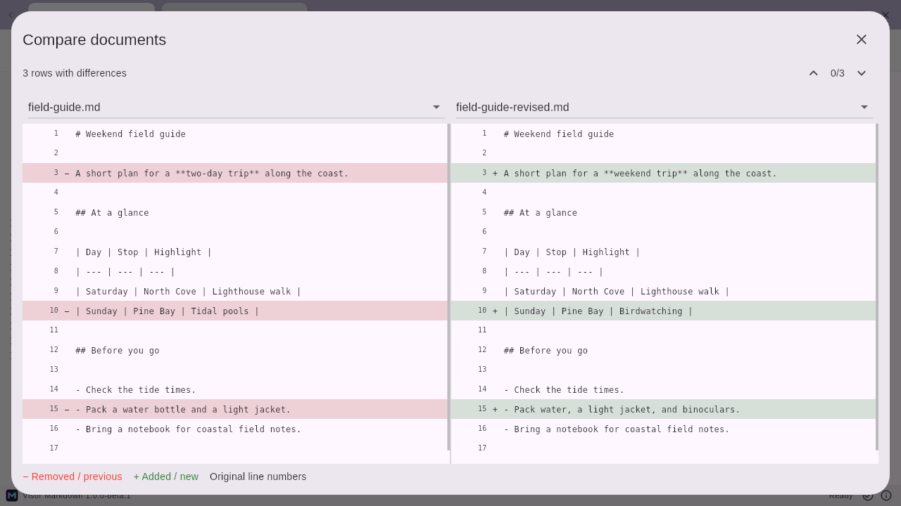

# Visor Markdown

[English](README.md) · [Español](README.es.md) · [Français](README.fr.md) · [Português](README.pt.md) · **Deutsch** · [Italiano](README.it.md)

**Markdown-Editor mit Vorschau**
Markdown-Dokumente schreiben, ansehen, vergleichen und teilen.

[Versionen und Downloads](RELEASES.md)

---

## Mit Markdown arbeiten

### Bearbeiten und ansehen

Schreiben Sie mit Zeilennummern und sehen Sie die formatierte Vorschau schon beim Tippen. Beim Scrollen folgt der andere Bereich derselben Textstelle.

### Organisieren und suchen

Öffnen Sie mehrere Dokumente in Tabs und springen Sie zwischen den Suchtreffern im aktuellen Dokument.

### Dokumente vergleichen

Prüfen Sie zwei Dateien nebeneinander. Änderungen sind hervorgehoben, und Sie können direkt von einem Unterschied zum nächsten springen.

### Formatieren und teilen

Wählen Sie GitHub Flavored Markdown, CommonMark oder Markdown Original. Fügen Sie im GitHub-Modus eine Beispieltabelle ein und exportieren Sie als PDF, HTML, Klartext oder Markdown.

### Darstellung anpassen

Übernehmen Sie das Systemdesign oder wählen Sie den hellen oder dunklen Modus. Passen Sie Farbpalette, Schriften und Schriftgrößen an.

---

[GPL-3-Lizenz](LICENSE)
