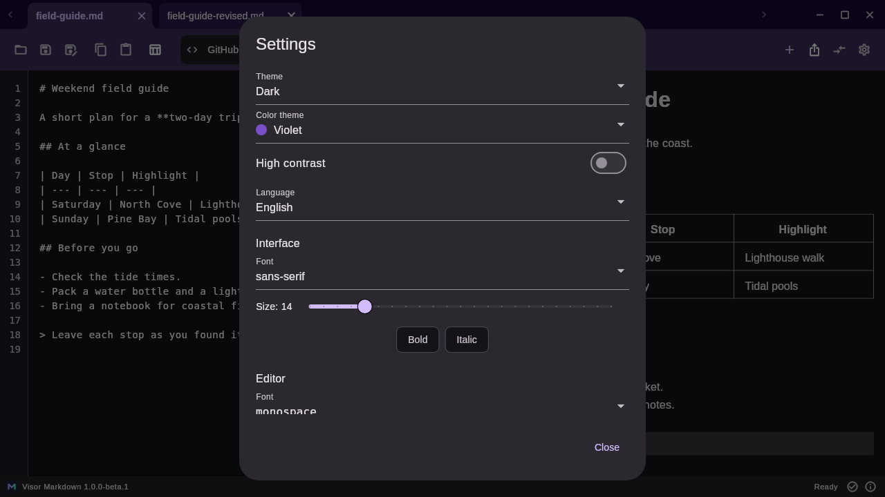

# Visor Markdown

[English](README.md) · **Español** · [Français](README.fr.md) · [Português](README.pt.md) · [Deutsch](README.de.md) · [Italiano](README.it.md)

**Editor y vista previa de Markdown**
Escribe, visualiza, compara y comparte documentos Markdown.

[Versiones y descargas](RELEASES.md)

---

## Trabaja con Markdown

### Edita y visualiza

Escribe con números de línea y ve el resultado formateado mientras escribes. Desplaza cualquiera de los paneles para seguir la misma parte del documento.

### Organiza y busca

Mantén varios documentos abiertos en pestañas y salta entre las coincidencias del documento actual.

### Compara documentos

Revisa dos archivos lado a lado, con los cambios resaltados y controles para saltar entre las diferencias.

### Da formato y comparte

Elige GitHub Flavored Markdown, CommonMark o Markdown Original. Inserta una tabla de ejemplo en el modo GitHub y exporta a Word (.docx), LibreOffice (.odt), PDF, HTML, texto plano o Markdown. Las exportaciones a Word y LibreOffice incrustan las imágenes compatibles con los mismos permisos que la vista previa.

### Personaliza la apariencia

Sigue el tema del sistema o elige el modo claro u oscuro. Ajusta la paleta, las fuentes y el tamaño del texto.

---

[Licencia GPL 3](LICENSE)
