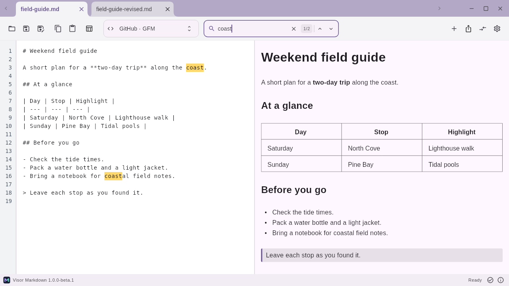

# Visor Markdown

[English](README.md) · [Español](README.es.md) · [Français](README.fr.md) · [Português](README.pt.md) · [Deutsch](README.de.md) · **Italiano**

**Editor e anteprima Markdown**
Scrivi, visualizza, confronta e condividi documenti Markdown.

[Versioni e download](RELEASES.md)

---

## Lavora con Markdown

### Modifica e visualizza

Scrivi con i numeri di riga e guarda il risultato formattato mentre digiti. Scorri uno dei pannelli per seguire lo stesso punto nell’altro.

### Organizza e cerca

Tieni aperti più documenti in schede e passa da un risultato di ricerca all’altro nel documento corrente.

### Confronta i documenti

Esamina due file affiancati, con le modifiche evidenziate e i comandi per passare da una differenza all’altra.

### Formatta e condividi

Scegli GitHub Flavored Markdown, CommonMark o Markdown Original. Inserisci una tabella di esempio in modalità GitHub ed esporta in PDF, HTML, testo semplice o Markdown.

### Personalizza l’aspetto

Segui il tema di sistema o scegli la modalità chiara o scura. Regola la palette, i caratteri e le dimensioni del testo.

---

[Licenza GPL 3](LICENSE)
