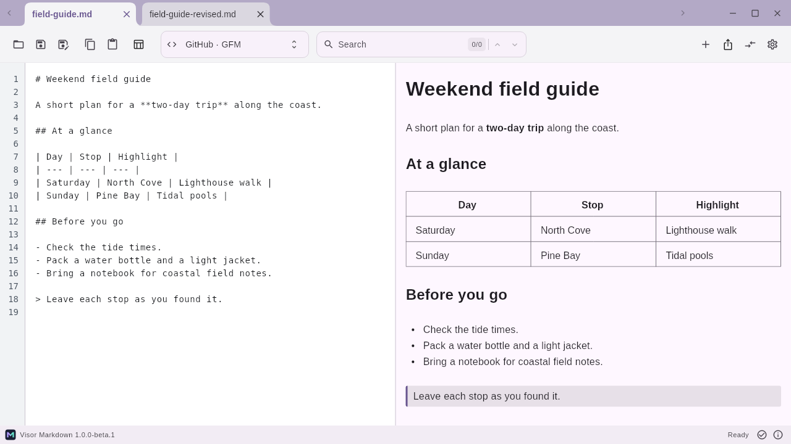
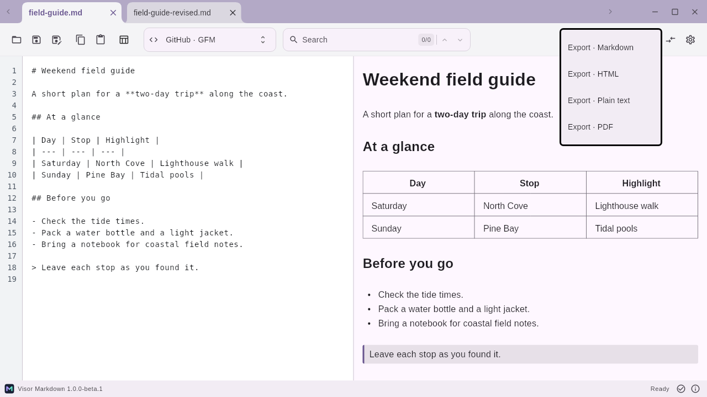

# Visor Markdown

**English** · [Español](README.es.md) · [Français](README.fr.md) · [Português](README.pt.md) · [Deutsch](README.de.md) · [Italiano](README.it.md)

**Markdown editor and preview**
Write, preview, compare, and share Markdown documents.

[Releases and downloads](RELEASES.md)

---

## Work with Markdown

### Edit and preview

Write with line numbers and see the formatted result as you type. Scroll either panel to follow the same part of the document.

### Organize and find

Keep several documents open in tabs and jump between matches in the current document.

### Compare documents

Review two files side by side, with changes highlighted and controls to jump between differences.

### Format and share

Choose GitHub Flavored Markdown, CommonMark, or Markdown Original. Insert a sample table in GitHub mode and export to PDF, HTML, plain text, or Markdown.

### Make it yours

Follow your system theme or choose light or dark mode. Customize the color palette, fonts, and text sizes.

---

[License GPL 3](LICENSE)
